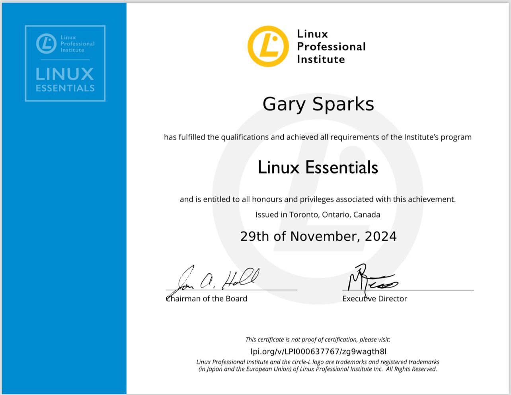

# About Me

I build things. If there's a problem I'd rather automate it away or build something that solves it than sit with it. By day I'm a DevOps engineer — Terraform, Ansible, Docker, Kubernetes — standing up infrastructure on AWS, Linode, and OVirt. I'm a Linux person through and through, and a NixOS convert: I manage most of my machines through a single [nixos-config](https://github.com/GSSparks/nixos-config) repo.

## Home Lab

A lot of what shows up on this blog comes from my home lab. At any given time I'm running Home Assistant, Nextcloud, Jellyfin, OPNsense, and Frigate — plus whatever new project has grabbed my attention that week. Self-hosting is partly pragmatic and partly philosophical: I'd rather own my stack than rent it.

## Projects

Most of what I build ends up on [GitHub](https://github.com/GSSparks). A few worth calling out:

- **[StackLore](https://stacklore.io)** — AI-generated infrastructure documentation. Connect a GitHub or GitLab repo and it automatically generates clear, searchable docs for your Ansible, Terraform, and CI/CD code. Built in Python.

- **[NutrifyIQ](https://nutrifyiq.com)** — An AI-powered meal planning and recipe app. Search a recipe database or generate new recipes based on what you have on hand.

- **[Scriptorium](https://github.com/GSSparks/Scriptorium)** *(rebranding as ScriptKata)* — A Bible study app. GPL licensed, built in collaboration with Claude.

## On AI

I use AI heavily — Claude specifically. It's not a shortcut; it's closer to a pair programmer who doesn't get tired. StackLore and Scriptorium are both projects that only got built because AI let me move fast enough to actually finish them. I don't see anything wrong with that.

# In My Toolbox:
|         |          |            |
|---------|----------|------------|
| Ansible | Bash     | Docker     |
| Git     | HAProxy  | Kubernetes |
| Linux   | MySQL    | Nginx      |
| Nix     | Python   | Vagrant    |
| Varnish |          |            |

# Certifications

## LE-1: Linux Essentials

[Click here for verification](https://cs.lpi.org/caf/Xamman/certification/verify/LPI000637767/zg9wagth8l)

# Let’s Connect

If something on the blog was useful, or you want to talk shop about Linux, home labs, or DevOps, feel free to reach out.
